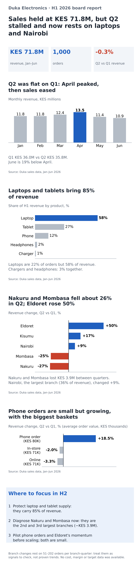

# PLP Data Analytics · Week 4 — Student EDA & Duka Board Report

Two engagements in one repository: finding the story (student performance EDA) and telling it (Duka board report and dashboard).

| Engagement | What | Main files |
|---|---|---|
| 1 · County education office | EDA on 1,200 students (seed 55): who is at risk and what is linked to better results | `student_eda.ipynb`, `figures/` |
| 2 · Duka Electronics board | One-page phone-friendly report for H1 2026 (seed 2026 data), a chart makeover and a dashboard | `board_report.ipynb`, `reports/duka_board_report.png`, `dashboard.md` |

## Board Summary (150 words)
Duka Electronics sold KES 71.8 million across 1,000 orders in the first half of 2026, but momentum stalled: second-quarter revenue was flat on the first quarter, down 0.3 percent. April was the strongest month at KES 13.5 million, while June was 19 percent lower. Two products, laptops and tablets, bring 85 percent of revenue, so supply problems there would hurt quickly. Mombasa and Nakuru, the second and third largest branches, fell by about a quarter each in the second quarter, losing KES 3.9 million together, while Nairobi grew 9 percent. Phone orders and Eldoret grew fastest, but both are small. We recommend three actions for the second half: protect laptop and tablet stock, investigate the Mombasa and Nakuru declines now, and pilot phone orders and Eldoret before investing more. These figures come from sales data only; branch changes rest on small order counts, so treat them as signals, not proof.

## Final one-page board report


PDF version: `reports/duka_board_report.pdf`. Chart makeover: `figures/before.png` and `figures/after.png`.

## Five key EDA insights (Engagement 1)
1. **Study hours is the strongest factor.** r = 0.70 with average score; each extra weekly hour is associated with about 2.1 points (R² = 0.50). The 99 At Risk learners (8.3%) study a median 2.1 h/week vs 4.5 h overall.
2. **Attendance is a second, independent factor.** r = 0.36; 23.9% of learners with attendance of 70% or less are At Risk, against 2.3% of those above 80%.
3. **A school-type gap of 5.5 points persists** in every attendance band and study-hour quartile (t-test p < 0.001). 94 of the 99 At Risk learners are in public schools (10.9% of public vs 1.5% of private learners).
4. **County and gender barely matter.** Nairobi has the highest At Risk share (9.2%), but the county spread is consistent with chance (χ² = 1.40, p = 0.92); the gender gap is 0.2 points (p = 0.73).
5. **Risk is concentrated and identifiable.** Study of 2.9 h/week or less, or attendance of 70% or less, flags 490 learners and captures 88.9% of the At Risk group, though most flagged learners are prevention cases (about 18% are currently below 60).

Full analysis, two recommendations and the Limitations section are in `student_eda.ipynb`.

## How to run
```bash
pip install -r requirements.txt
python generate_data.py     # seed 55 -> student_performance.csv; seed 2026 -> duka_sales.csv
python duka_prep.py         # cleans duka_sales.csv -> duka_sales_clean.csv (also called by board_report.ipynb)
jupyter nbconvert --to notebook --execute --inplace student_eda.ipynb     # regenerates the EDA figures
jupyter nbconvert --to notebook --execute --inplace board_report.ipynb    # regenerates reports/ and before/after
```
Do not change the seeds.

## Repository structure
```
README.md                      this file
generate_data.py               both generators, unchanged (seed 55 students, seed 2026 Duka)
student_eda.ipynb              Structure, Univariate, Bivariate, Multivariate, Hypotheses, Findings, Recommendations, Limitations
board_report.ipynb             storyboard (audience, decision, Big Idea, SCR), cleaned data, chart code, before/after makeover
duka_prep.py                   Duka cleaning rules and derived columns (revenue, month, quarter, weekday, is_weekend, price_band)
duka_sales_clean.csv           cleaned Duka sales with derived columns (1,000 orders)
figures/                       EDA charts 01-07 plus before.png and after.png
reports/                       duka_board_report.png and .pdf (one page)
dashboard.md                   Looker Studio dashboard: link, build steps, screenshots
looker_data/                   data file for the Looker Studio dashboard
prototype/                     HTML prototype of the dashboard (design reference)
screenshots/                   dashboard screenshots
student_performance.csv, duka_sales.csv   generated data
requirements.txt
```
