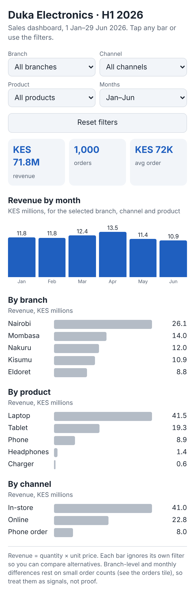
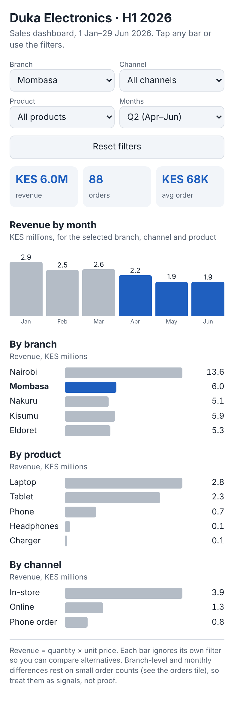

# Duka Electronics · H1 2026 dashboard

> **STATUS: complete this file before submitting.** A public Looker Studio link can only be created from your own Google account, so it is **not** filled in below. Follow the steps, then replace the placeholders marked ⚠️.

**Public Looker Studio link:** ⚠️ https://datastudio.google.com/reporting/0ba309f5-233e-4486-8cc6-c673a66defdd (Share → Manage access → *Anyone with the link* → Viewer)

## Build steps (about 20 minutes)
1. **Load the data.** Upload `looker_data/duka_sales_for_looker.csv` to Google Sheets (File → Import), or use Looker Studio's *File Upload* connector. It has 1,000 rows with `order_date`, `month`, `quarter`, `branch`, `product`, `channel`, `quantity`, `unit_price`, `revenue` and `price_band`.
2. **Create the report.** At lookerstudio.google.com choose Create → Report → add your sheet as the data source. Set `order_date` to *Date (YYYYMMDD)* and `revenue` to *Number → Currency (KES)*.
3. **Add a calculated field** `avg_order_value` = `SUM(revenue) / COUNT(order_id)`.
4. **Scorecards (top row):** `SUM(revenue)`, `COUNT(order_id)` (orders) and `avg_order_value`. Use large numbers and short labels.
5. **Trend:** a time series (or column chart) of `SUM(revenue)` by `month`, with a title that states the insight, for example "Q2 was flat on Q1: April peaked".
6. **Breakdowns:** three bar charts of `SUM(revenue)` by `branch`, by `product` and by `channel`, each sorted descending. Highlight one bar colour (blue) and keep the rest grey.
7. **Filter controls:** drop-down lists for `branch`, `channel` and `product`, and a date range control on `order_date`.
8. **Share:** Share → Manage access → *Anyone with the link* → Viewer; copy the link into the placeholder above.
9. **Screenshots:** with the dashboard showing, take one full-page screenshot and one with a filter applied (for example Branch = Mombasa). Save them as `screenshots/looker_1_overview.png` and `screenshots/looker_2_filtered.png`, then replace the placeholders below.

## Screenshots (Looker Studio)
⚠️ ``
⚠️ ``

## Prototype of the same design (HTML build, not Looker Studio)
These screenshots come from the HTML prototype in `prototype/dashboard.html`. They show the intended layout (scorecards, monthly trend, branch/product/channel breakdowns and filter controls) and the numbers your Looker Studio build should reproduce. **Replace them with your Looker Studio screenshots above before submitting.**

## Numbers to check your build against
Total revenue KES 71,792,500; 1,000 orders; average order value KES 71,793. Filtered to Mombasa and Q2: KES 5,980,600 from 88 orders.
